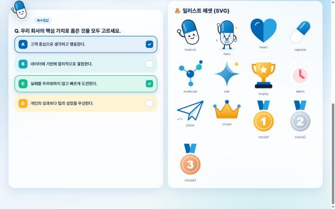

# 💙 휴온스 퀴즈 챌린지 — 교재만 올리면 끝나는 온라인 시험 플랫폼

휴온스 교육 담당자를 위한 **사내 시험 앱**입니다. (원본: [1970jjh/hyundai-exam](https://github.com/1970jjh/hyundai-exam)을 휴온스 브랜드·디자인으로 바꾼 버전)
교재(PDF·PPT·워드)를 올리면 AI가 문제를 만들고, 강의장에서 **QR 하나로 휴대폰 시험**을 치르고,
시험이 끝나는 순간 **자동 채점 · 정답/해설 공개 · 통계 대시보드 · 보고서(HTML/Word/PDF)** 까지 한 번에 끝납니다.

> 시험지 출력 → 배부 → 채점 → 집계 → 그래프 → 보고서 작성… 이 반나절 일을 **버튼 몇 번**으로.

| 첫 화면 | 디자인 시스템 (/design) |
|---|---|
|  |  |

---

## ✨ 주요 기능

**관리자**
- 📄 교재 업로드(PDF·PPTX·DOCX·TXT, 여러 파일) → **AI 자동 출제** (Gemini)
- 🧩 유형별 문항 수 지정: **객관식(4지선다) / 복수정답 / 단답형 / 서술형**
- ✏️ 문항·보기·정답·해설·배점 직접 수정, 문항 추가·삭제·순서 변경
- ⏱ 제한시간·마감 경고 시점·합격 기준 설정, 시험 중 **시간 연장(+1분/+5분)**
- 📱 «시험 시작» → 큰 **QR·링크·입장코드** 화면, 실시간 입장/제출 현황
- ⏹ «전체 시험 종료» 또는 시간 만료 시 **자동 종료 + 미제출자 자동 제출**

**학습자(휴대폰)**
- QR 찍고 이름·이메일·소속 입력 → 대기실 → 시작되면 문제가 자동으로 뜸
- 우측 상단에 **내 이름 + 남은 시간(링 타이머)**, 마감이 다가오면 **빨간 경고**
- 답은 자동 저장(새로고침·재접속해도 이어서), 제출 후에도 **정답은 시험이 끝날 때까지 비공개**
- 종료 즉시 **내 점수·등수·문항별 정오·정답·해설** 공개, PDF 저장

**결과 · 보고**
- 응시자 수·평균·중앙값·**표준편차**·최고/최저·사분위·합격률·**신뢰도(KR-20)**
- 점수대 도넛, TOP3 포디움, 점수 분포, 유형별·문항별 정답률, **문항 변별도**, 소요시간-점수 산점도, 보기별 선택 분포, 취약 문항 Top5
- 팀장님 보고용 **종합 리포트: HTML / Word(.docx) / PDF 출력 / CSV**
- **개인 리포트 메일 일괄 발송**(Gmail) 또는 zip 다운로드
- 서술형은 시험 종료 시 **AI가 자동 채점** → 관리자가 점수 수정 가능, 정답 정정 시 자동 재채점

**보안**: 문제·정답 데이터는 DB에서 완전히 잠겨 있고, 정답·해설은 시험이 끝나기 전에는 어떤 경로로도 휴대폰에 내려가지 않습니다.

---

## 🚀 설치 방법 (약 15분, 모두 무료)

준비물: **GitHub 계정**, **Supabase 계정**(무료 DB), **Vercel 계정**(무료 호스팅), **Gemini API 키**(무료 발급)

### 1단계. Supabase(데이터베이스) 만들기
1. https://supabase.com 접속 → GitHub로 가입 → **New project** (지역은 `Northeast Asia (Seoul)` 추천)
2. 왼쪽 메뉴 **SQL Editor** → 이 저장소의 [`supabase/schema.sql`](supabase/schema.sql) 내용을 **통째로 복사해 붙여넣고 Run**
3. **Project Settings → API** 에서 두 값을 메모
   - `Project URL` (예: `https://abcd1234.supabase.co`)
   - `Publishable key` (`sb_publishable_...`) — 없으면 `anon public` 키

### 2단계. Gemini API 키 발급
https://aistudio.google.com/apikey → **Create API key** → 키 메모

### 3단계. Vercel로 배포 (버튼 한 번)
[](https://vercel.com/new/clone?repository-url=https%3A%2F%2Fgithub.com%2Fyangsuyeon30-pixel%2Fhuons-exam&project-name=huons-quiz&repository-name=huons-quiz&env=NEXT_PUBLIC_SUPABASE_URL,NEXT_PUBLIC_SUPABASE_KEY,GEMINI_API_KEY&envDescription=Supabase%20URL%2C%20Supabase%20Publishable%20key%2C%20Gemini%20API%20key)

위 버튼 → Vercel 로그인(GitHub) → 아래 3개 값 입력 → **Deploy**

| 이름 | 값 |
|---|---|
| `NEXT_PUBLIC_SUPABASE_URL` | 1단계의 Project URL |
| `NEXT_PUBLIC_SUPABASE_KEY` | 1단계의 Publishable key |
| `GEMINI_API_KEY` | 2단계의 Gemini 키 |

2~3분 뒤 `https://내프로젝트.vercel.app` 주소가 생기면 설치 끝! 🎉

### 4단계(선택). 개인 리포트 메일 발송 켜기 — Gmail
1. 보낼 Gmail 계정에 **2단계 인증**을 켠 뒤 https://myaccount.google.com/apppasswords 에서 **앱 비밀번호(16자리)** 생성
2. Vercel 프로젝트 → **Settings → Environment Variables** 에 아래 값을 추가하고 **Redeploy**

| 이름 | 값 |
|---|---|
| `GMAIL_USER` | 보내는 Gmail 주소 |
| `GMAIL_APP_PASSWORD` | 16자리 앱 비밀번호 |
| `MAIL_FROM_NAME` (선택) | 보내는 사람 이름 (예: `OO교육팀`) |

> 설정하지 않아도 앱은 정상 작동합니다. 이때 메일 버튼은 «설정 필요»로 표시되고, 개인 리포트는 zip으로 받아 전달할 수 있습니다.

### 🔑 관리자 비밀번호
- 초기 비밀번호: **`123456`**
- **설치 후 꼭 바꾸세요.** Supabase → SQL Editor 에서 아래 한 줄 실행 (`새비밀번호` 자리에 원하는 값):
```sql
update hx_admin set pass_hash = extensions.crypt('새비밀번호', extensions.gen_salt('bf')) where id = 1;
```

---

## 📖 사용 방법

### 시험 준비 (관리자)
1. `https://내주소/admin` → 비밀번호 입력
2. **＋ 새 챌린지 만들기** → 시험 제목·과정명·제한시간·경고 시점·합격 기준 입력
3. **교재 파일 업로드** → 유형별 문항 수 지정(예: 객관식 10 · 복수정답 3 · 단답형 4 · 서술형 1) → **✨ AI로 문제 생성하기** (약 15~60초)
4. 생성된 문항을 검토하고 필요하면 수정(정답은 보기 오른쪽 체크) → **💾 저장**

### 시험 당일 (강의장)
1. 시험 목록에서 **🚀 시험 진행** → 프로젝터에 **QR 화면**을 띄움
2. 학습자는 휴대폰 카메라로 QR → 이름·이메일·소속 입력 → 대기
3. 입장 인원을 확인하고 **🚀 시험 시작** → 모든 폰에 문제가 동시에 뜸
4. 진행 화면에서 제출 현황·남은 시간 확인, 필요하면 **+1분/+5분 연장**
5. 시간이 끝나면 자동 종료(또는 **⏹ 전체 시험 종료**) → 학습자 폰에 즉시 결과·해설 공개

### 시험 후 (보고)
1. **📊 결과 대시보드** → 통계·그래프 확인 (서술형 점수는 「상세」에서 수정 가능)
2. 팀장님 보고: **HTML 리포트 / Word / PDF 출력 / CSV**
3. 학습자에게: **✉️ 전원 메일 발송**(Gmail 설정 시) 또는 **zip 다운로드**
4. 같은 시험을 다른 차수에 쓰려면 목록에서 **복제**

### 💡 팁
- 학습자 20명 동시 응시로 실배포 테스트를 마쳤습니다.
- 학습자가 폰을 껐다 켜도 같은 이름·이메일로 다시 들어오면 이어서 풉니다.
- 스캔 이미지로만 된 PDF는 글자를 읽을 수 없어요. 텍스트가 있는 파일을 올려 주세요.

---

## 🛠 기술 구성
Next.js 15 · Supabase(Postgres, 보안 RPC 함수) · Gemini 3.8 Flash · Chart.js · docx · Vercel

```
app/            화면(관리자 /admin, 학습자 /e/[코드], 디자인 시스템 /design) + API
lib/            통계·리포트·내보내기·교재 텍스트 추출
supabase/       schema.sql (DB 설치 스크립트)
docs/           DESIGN.md(디자인 명세)·스크린샷
```

로컬 실행: `.env.example`을 `.env.local`로 복사해 값을 채운 뒤 `npm install && npm run dev`

## 📜 라이선스
MIT — 원본 제작: **JJ Creative 교육연구소** ([1970jjh/hyundai-exam](https://github.com/1970jjh/hyundai-exam)). 휴온스 버전은 브랜드·디자인만 바꿨고 기능은 원본과 같습니다.

> 휴온스 이름과 브랜드 컬러는 사내 교육용으로만 사용하세요. 마스코트·장식 일러스트는 이 저장소에서 새로 그린 SVG(`public/img/*.svg`)입니다.
